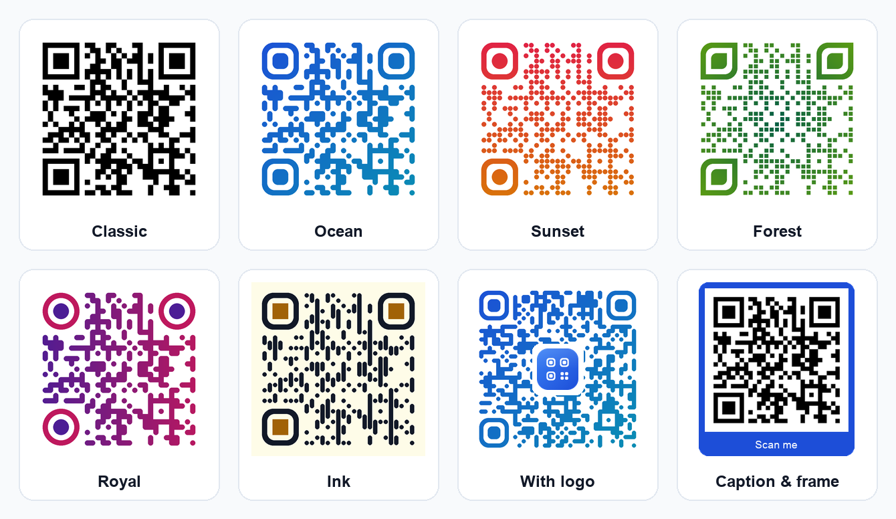

<div dir="rtl" align="right">

<div align="center">


# QR Studio: برنامج مجاني لإنشاء رموز QR على ويندوز وماك

أنشئ رموز QR للروابط والواي فاي وجهات الاتصال وواتساب والمواقع والمواعيد.
أضف ألوانك وشعارك، وتأكد أن الرمز يُقرأ، ثم احفظه بصيغة PNG أو SVG أو PDF.
يعمل بدون إنترنت، بلا إعلانات ولا تسجيل ولا علامة مائية، والرموز لا تنتهي صلاحيتها.

**[استخدمه أونلاين بدون تحميل](https://qr-studio-web-yliw.onrender.com)** · يعمل على الموبايل والكمبيوتر

[English](README.md) · **العربية**



</div>

## التحميل

حمّل البرنامج من **[آخر إصدار](https://github.com/lordmustafa/QR-Studio/releases/latest)**:

- **ويندوز 10 و11:** الملف `QR Studio.exe`. ملف واحد يعمل مباشرة بدون تثبيت وبدون بايثون.
- **ماك بمعالج Apple Silicon:** الملف الذي ينتهي بـ `macOS-arm64.dmg`.
- **ماك بمعالج Intel:** الملف الذي ينتهي بـ `macOS-x86_64.dmg`.

على الماك افتح ملف `.dmg` واسحب البرنامج إلى مجلد Applications.

لا تريد التثبيت؟ استخدم **[نسخة الويب](https://qr-studio-web-yliw.onrender.com)** من أي متصفح على الموبايل أو الكمبيوتر.
فيها نفس أنواع الرموز والأنماط والفحص، ولا تحفظ أي شيء تكتبه.

البرنامج غير موقّع بشهادة مدفوعة، لذلك يظهر تنبيه في أول تشغيل:

- **ويندوز:** تظهر رسالة "Windows protected your PC". اضغط **More info** ثم **Run anyway**.
- **ماك:** اضغط على البرنامج بالزر الأيمن واختر **Open** ثم **Open** مرة ثانية. هذا مطلوب مرة واحدة فقط.

## ماذا تستطيع أن تنشئ

| النوع | ماذا يحدث عند مسح الرمز |
|---|---|
| رابط | يفتح موقعاً |
| نص | يعرض أي نص |
| واي فاي | يتصل بالشبكة بدون كتابة كلمة المرور |
| جهة اتصال | يحفظ الاسم والشركة والوظيفة والهاتف والإيميل والموقع والعنوان |
| إيميل | يفتح رسالة جديدة بالعنوان والموضوع والنص |
| رسالة SMS | يفتح رسالة نصية لرقم |
| اتصال | يتصل برقم |
| واتساب | يفتح محادثة واتساب برسالة جاهزة |
| موقع | يفتح مكاناً على الخريطة |
| موعد | يضيف موعداً إلى التقويم |

الحقول تُفحص أثناء الكتابة، فيظهر الخطأ في رقم الهاتف أو الإيميل أو التاريخ قبل الحفظ.
الأرقام العربية (٠١٢٣) مقبولة أيضاً.

## المميزات

- معاينة مباشرة تتحدث مع كل حرف تكتبه أو تمسحه
- 6 أنماط جاهزة، وتدرج لوني، و7 أشكال للنقاط، و4 أشكال للزوايا
- شعارك في وسط الرمز، ونص تحت الرمز (يدعم العربية) وإطار ملون
- يقرأ البرنامج كل رمز بنفسه ويعرض **✓ جاهز للاستخدام** عندما يعمل الرمز
- تنبيه عندما يكون التباين بين اللون والخلفية ضعيفاً
- الحفظ بصيغ PNG وJPG وSVG وPDF وWEBP وBMP، أو النسخ إلى الحافظة
- **عدة رموز:** مئات الرموز مرة واحدة من قائمة أو ملف `.txt` أو `.csv`
- **قراءة رمز:** قراءة رموز QR من صورة أو لقطة شاشة
- **السجل:** البحث في الرموز السابقة وفتحها من جديد
- واجهة عربية وإنجليزية تتبع لغة النظام، ووضع فاتح وداكن
- كل شيء يعمل على جهازك، وكلمات مرور الواي فاي لا تُحفظ أبداً

## طريقة الاستخدام

1. في صفحة **رمز جديد** اختر نوع الرمز، مثلاً **واي فاي**.
2. اكتب المعلومات، والمعاينة تتحدث مباشرة.
3. اختر نمطاً، أو غيّر الألوان وأضف شعارك.
4. عندما تظهر علامة **✓ جاهز للاستخدام** اضغط **تحميل**.

الشرح الكامل لكل صفحة وخيار موجود في [دليل الاستخدام](docs/USER_GUIDE.md) (بالإنجليزية).

## التشغيل من الكود

تحتاج بايثون 3.10 أو أحدث:

```bash
git clone https://github.com/lordmustafa/QR-Studio.git
cd QR-Studio
./run.sh
```

على ويندوز اضغط مرتين على `run.bat`. طريقة بناء ملف `.exe` أو `.dmg` بنفسك موجودة في
[docs/BUILDING.md](docs/BUILDING.md).

## أسئلة شائعة

**هل البرنامج مجاني فعلاً؟**
نعم. مفتوح المصدر برخصة MIT، بلا إعلانات ولا حساب ولا اشتراك.

**هل تنتهي صلاحية الرموز؟**
لا. المحتوى مخزن داخل الرمز نفسه، ولا يمر عبر أي خادم.

**هل أستطيع استخدامه للمطاعم والمتاجر والطباعة؟**
نعم، بدون أي قيود. للطباعة احفظ الرمز بصيغة SVG أو PDF حتى يبقى واضحاً بأي حجم.

## الرخصة

[MIT](LICENSE). يمكنك الاستخدام والتعديل والمشاركة، حتى للأعمال التجارية.

</div>
