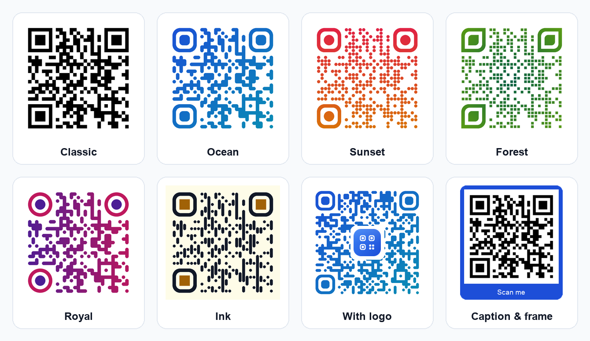

<div align="center">


# QR Studio: free QR code generator for Windows and macOS

Make QR codes for links, Wi-Fi, contacts, WhatsApp, locations and events.
Add your colors and logo, check that the code scans, then save it as PNG, SVG or PDF.
Works offline. No ads, no sign-up, no watermark, and the codes never expire.

[](https://github.com/lordmustafa/QR-Studio/releases/latest)
[](https://github.com/lordmustafa/QR-Studio/actions/workflows/build.yml)
[](LICENSE)


**[Use it online, no download](https://qr-studio-web-yliw.onrender.com)** · works on phones and computers

**English** · [العربية](README.ar.md)



</div>

## Download

| System | File | Notes |
|---|---|---|
| Windows 10 / 11 | `QR Studio.exe` | One file. No install and no Python needed. |
| macOS (Apple Silicon) | `QR-Studio-…-macOS-arm64.dmg` | Open the disk image and drag the app to Applications. |
| macOS (Intel) | `QR-Studio-…-macOS-x86_64.dmg` | Same as above. |

Get them from the **[latest release](https://github.com/lordmustafa/QR-Studio/releases/latest)**.

The apps are free and not signed with a paid certificate, so the first launch shows a warning:

- **Windows:** SmartScreen shows "Windows protected your PC". Click **More info**, then **Run anyway**.
- **macOS:** right-click the app, choose **Open**, then **Open** again. You only do this once.

No install? Use the **[web version](https://qr-studio-web-yliw.onrender.com)** in any browser, on a phone or a computer. It has the same
code types, styles and checks, and it does not save what you type.

On Linux, or to run from source, see [Run from source](#run-from-source).

## What you can make

| Type | What the code does when scanned |
|---|---|
| Link (URL) | Opens a website |
| Text | Shows any text |
| Wi-Fi | Joins a Wi-Fi network without typing the password (WPA/WPA2, WEP or open) |
| Contact (vCard) | Saves a contact: name, company, job title, phone, email, website, address |
| Email | Starts an email with the address, subject and message filled in |
| SMS | Starts a text message to a number |
| Phone call | Dials a number |
| WhatsApp | Opens a WhatsApp chat with a ready message |
| Location | Opens a place on the map (coordinates or a Google Maps link) |
| Event | Adds a calendar event with start, end and place |

Fields are checked while you type, so a wrong phone number, email, date or coordinate is
marked before you save.

## Features

**Design**
- Live preview that updates as you type
- 6 ready styles: Classic, Ocean, Sunset, Forest, Royal, Ink
- Solid color or gradient (horizontal, vertical, diagonal, radial), any background, or transparent
- 7 dot shapes: square, rounded, circle, gapped, diamond, vertical bars, horizontal bars
- 4 corner shapes (square, rounded, circle, leaf), each with its own color
- Your logo in the middle (5–30 % of the code), with an optional white plate behind it
- A caption under the code and an optional colored frame. Arabic captions are supported.

**Quality**
- Every code is read back by the app and marked ✓ when it scans to the same content
- Warnings for low contrast and for light codes on dark backgrounds
- Error correction L / M / Q / H. It switches to H by itself when you add a logo.

**Export**
- PNG (300 dpi, transparent background), JPG, **SVG (true vector)**, PDF, WEBP, BMP
- Sizes from 256 to 4096 px
- Copy the image or the content to the clipboard. `Ctrl+S` / `Cmd+S` saves.

**More tools**
- **Many codes:** paste a list or open a `.txt` / `.csv` file and get a folder of codes in your design
- **Read a code:** read QR codes from an image file or from the clipboard
- **History:** find, reopen and delete the codes you saved

**App**
- Arabic and English interface. It follows your system language, and you can change it in the sidebar.
- Light and dark themes
- Fits small windows and large screens
- Private: everything runs on your computer. Wi-Fi passwords are never written to disk.

## How to use it

1. On **New code**, pick what the code is for, for example **Wi-Fi**.
2. Fill in the fields. The preview updates as you type.
3. Pick a style, or change the colors and add your logo.
4. Wait for **✓ Ready to use**, which means the app scanned the code, then click **Download**.

The [user guide](docs/USER_GUIDE.md) explains every page, field and option.

## Run from source

You need Python 3.10 or newer with Tk. The python.org installers include Tk. On Linux, install `python3-tk`.

```bash
git clone https://github.com/lordmustafa/QR-Studio.git
cd QR-Studio
./run.sh          # macOS / Linux
```

On Windows, double-click `run.bat`. Both scripts create a virtual environment and install
the packages the first time.

Or set it up by hand:

```bash
python3 -m venv .venv
.venv/bin/pip install -r requirements.txt
.venv/bin/python main.py
```

To build the Windows `.exe` or the macOS `.dmg` yourself, see [docs/BUILDING.md](docs/BUILDING.md).

## FAQ

**Is it really free?**
Yes. It is open source under the MIT license, with no ads, no account and no paid plan.

**Do my QR codes expire?**
No. QR Studio makes static codes, so the content is stored inside the code itself.
Nothing goes through a server that could stop working.

**Can I use the codes for business, menus or print?**
Yes, with no limits. For print, use SVG or PDF so the code stays sharp at any size.

**Does it need the internet?**
No. Everything runs on your computer.

**Can I put my logo in the middle?**
Yes. The app raises error correction to H so the code still scans, and checks it for you.

**Can I make many codes at once?**
Yes. Use the **Many codes** page with a list or a CSV file.

## Documentation

- [User guide](docs/USER_GUIDE.md): every page and option, with tips for print
- [Building](docs/BUILDING.md): run the tests and build the Windows and macOS apps
- [Contributing](CONTRIBUTING.md): report a bug or send a change
- [Changelog](CHANGELOG.md)

## Project layout

```
main.py                  entry point (--selftest checks a built app)
packaging/build.py       PyInstaller build: Windows .exe, macOS .app + .dmg, icons
packaging/make_docs_images.py   pictures for the README and the website
qr_studio/
  payloads.py            form values -> QR text (Wi-Fi, vCard, event, ...) and field checks
  renderer.py            QR matrix -> styled image (shapes, gradients, logo, frame)
  exporter.py            PNG / JPG / PDF / WEBP / BMP and vector SVG
  scanner.py             read codes with OpenCV
  storage.py             settings and history (JSON in ~/.qr_studio)
  brand.py               the app logo, drawn in code
  i18n.py                English and Arabic text
  ui/                    CustomTkinter window and pages
tests/test_core.py
```

## License

[MIT](LICENSE). You can use, change and share it, including for commercial work.
